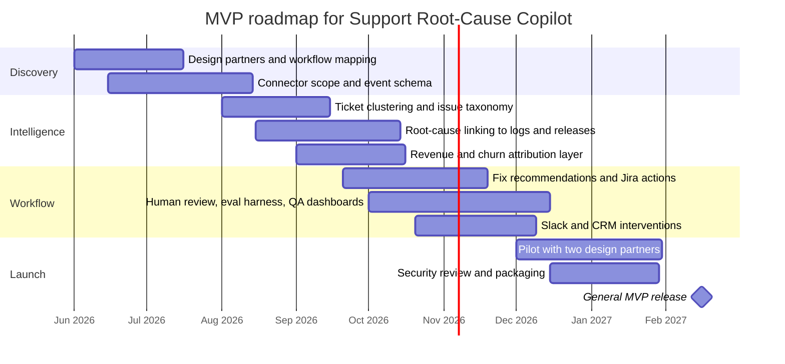

# AI Product Ideas Worth Building and Selling

## Executive summary

- The strongest commercial opportunities are not another general chatbot. They are workflow-native systems in functions where spending is already concentrating: customer service, sales and procurement, healthcare administration, compliance, and vertical operations. Enterprise generative-AI spend reached an estimated **$37 billion in 2025**, with **$19 billion** in the application layer, and healthcare alone represented roughly **$1.5 billion** of vertical-AI spend. citeturn6view0turn6view4turn6view1
- Claude is especially attractive as the **reasoning and orchestration layer** for sellable products because Claude 4 supports **up to a 1M-token context window**, **MCP**, **prompt caching**, **tool search**, and **computer use**. In practice, though, the winning stack is usually **Claude plus retrieval, narrow tools, smaller specialist models, and human review**, because browsing agents and RAG pipelines still have important security and grounding failure modes. citeturn7view5turn7view2turn7view3turn7view4turn7view1turn9view4turn10view1
- Near-term revenue is likeliest in categories with an obvious budget owner and measurable ROI: **trust and compliance**, **support intelligence**, **procurement**, **denials and appeals**, **construction claims**, and **security design review**. Those categories are already validated by fast-growing application vendors and by enterprise survey data on where AI value clusters. citeturn8view4turn9view0turn18view0turn8view2turn15view1turn16view0turn6view4
- The highest-upside but riskier ideas sit where AI becomes a **system of decision**, not just a system of drafting: **synthetic customer boards**, **pricing labs**, **science-to-patent scouting**, and **workforce redeployment operating systems**. These will only become durable products if they are grounded in proprietary customer or enterprise data, not generic model output. 

## Market signals and design principles

Business adoption is no longer speculative. Stanford’s 2025 AI Index reports that **78% of organisations said they were using AI in 2024**, while global private investment in generative AI reached **$33.9 billion**. Menlo Ventures estimates that enterprise generative-AI spend rose to **$37 billion in 2025**, with the application layer taking the largest share at **$19 billion**. McKinsey’s 2025 workplace analysis further suggests that the most economically valuable functional areas are **sales and marketing**, **software engineering**, **customer service**, and **R&D**. That combination points founders towards products that remove labour from repeated, document-heavy, multi-system work rather than “AI for everything” positioning. citeturn6view1turn6view0turn6view4

On the technical side, Claude is unusually well suited to products that need long-running, high-context workflows. Anthropic’s current platform supports **1M-token context** on Claude 4 models, **prompt caching** for repeated prefixes, **MCP** as an open standard for connecting tools and data, **tool search** for large tool libraries, and **computer use** where UI automation is unavoidable. Anthropic’s own Economic Index also shows API usage clustering around tasks that are increasingly selected for automation, including coding and back-office work such as email handling, document processing, CRM, and scheduling. That is a strong signal to design products around **repeatable task loops with narrow actions**, not around free-form chat. 

The main product-design constraint is reliability. Research on browsing agents shows they remain vulnerable to **prompt injection, credential exposure, and unsafe execution paths**, while recent RAG surveys emphasise persistent trade-offs around **faithfulness, retrieval noise, adversarial robustness, and evaluation**. In other words: for commercial products, the safest and most sellable architecture is usually **Claude as the planner/reasoner**, with **retrieval over trusted corpora**, **typed actions**, **sandboxed browser steps only when needed**, and **human approval at economic or regulatory decision points**. citeturn9view4turn10view1turn9view3

Competitive dynamics also matter. Focused application companies have already proved that buyers will pay for vertical or workflow-specific AI: Harvey in legal, Abridge in clinical documentation, Decagon and Maven in customer operations, Rogo in finance, Levelpath in procurement, Vanta and Drata in compliance, and Procore/OpenSpace in construction. On the consumer side, a16z’s latest work suggests the opposite dynamic for general assistants: usage and spend are concentrating around a handful of horizontal products, while **dedicated, opinionated interfaces** still leave white space for start-ups. That makes it rational to avoid building a generic assistant and instead build a **narrow operating system around one expensive workflow**. 

The tables below mix **near-term feasible products** and **asymmetric bets**. Difficulty is implementation difficulty, not market attractiveness. Revenue model, differentiation, and GTM are my assessments based on the cited market and technical evidence.

## Near-term buildable products

| Idea | Target customers | Core AI components | Differentiator vs existing solutions | Primary revenue model | Difficulty | One-sentence go-to-market tactic | Evidence |
|---|---|---|---|---|---|---|---|
| **TrustGraph Exchange** — Auto-complete vendor security reviews from verified evidence packs and live control mappings. | B2B SaaS vendors, security/GRC teams, sales engineering | Claude Sonnet/Opus for answer drafting and control reasoning; graph RAG over policies and evidence; document parsers; optional portal autofill | The moat is a reusable **cross-customer evidence graph** and buyer-side acceptance workflow, not just a trust centre or answer generator. | Annual SaaS + per-questionnaire usage + buyer-side premium seats | Medium | Start with vendors handling many enterprise security reviews each quarter and sell through the sales-engineering pain of delayed deals. | Conveyor, Vanta, Drata, and OneTrust all validate real spend in trust and risk workflows.  |
| **Support Root-Cause Copilot** — Turn tickets, chats, logs, billing events, and release data into ranked product fixes and churn-risk actions. | B2B SaaS, fintech, marketplaces | Claude for cross-source reasoning; embeddings + knowledge graph; anomaly detection; call/transcript summarisation | Most CX AI tools optimise front-line deflection; this one optimises the **feedback loop from support to engineering and revenue retention**. | SaaS priced by ticket volume + premium analytics module | Medium | Sell to scale-ups where support volume is rising faster than product quality teams can analyse it. | Customer-service value is substantial in McKinsey’s analysis, and Decagon/Maven validate willingness to pay for AI in support operations.  |
| **Procurement Negotiation Twin** — Read quotes, MSAs, renewal histories, and benchmarks to propose negotiation levers, redlines, and negotiation scripts. | Mid-market enterprises, procurement teams, sourcing consultancies | Claude for contract reasoning and strategy; benchmark retrieval; clause classifier; email drafting | Unlike intake-focused procurement tools, this product owns the **negotiation memory** and savings logic across renewal cycles. | Seat-based SaaS + savings-share add-on | Medium | Land in indirect-spend-heavy organisations during renewal season and prove savings on a handful of vendors first. | Levelpath shows procurement buyers are adopting AI-native products, and application-layer spend is moving decisively into departmental software. citeturn8view6turn6view0 |
| **Bid and No-Bid Strategist** — Score tenders, draft evidence-backed responses, and simulate likely evaluator objections before you burn delivery hours. | IT services firms, MSPs, consultancies, GovTech vendors | Claude for long-context RFP reasoning; RAG over proposal libraries and case studies; evaluator simulation agents | The wedge is **decision quality before writing**, not just faster proposal drafting. | Per-seat licence + per-submission credits | Medium | Target consultancies with repeat tender workflows and visibly low bid-win rates. | Conveyor already treats RFP automation as a sellable adjacent workflow, while Claude’s long-context features suit proposal reasoning.  |
| **Mid-Market Diligence Agent** — Review data rooms and produce issue lists, synergy hypotheses, and red-flag memos with citations for sub-scale deals. | Lower-mid-market PE funds, search funds, corp-dev teams | Claude Opus for dense document and spreadsheet reasoning; valuation data retrieval; workflow automation | Existing finance/legal AI is strongest at the top end; this product is tuned for **lean deal teams** with many small transactions. | Per-deal fee + annual retainer | High | Start with boutique funds and quality-of-earnings advisers that repeatedly review similar smaller deals. | Rogo validates financial-institution demand and Harvey validates long-document legal workflow demand. citeturn8view5turn8view0 |
| **Contract Obligation OS** — Convert signed contracts into live reminders, SLAs, compliance tasks, and exception alerts across the business. | Legal ops, revenue ops, outsourcing firms, healthcare providers | Claude for clause extraction and obligation reasoning; MCP/workflow connectors; small NER models | Most CLM products stop at storage or search; this becomes a **post-signature system of action**. | Annual SaaS priced by contract volume | Medium | Sell where renewal leakage, service-credit risk, or missed obligations have obvious cash impact. | Harvey shows continued legal demand; MCP makes multi-system action layers more practical. |
| **Field-Service Voice Triage** — A voice-first technician assistant that diagnoses faults from spoken symptoms, manuals, images, and parts data. | Industrial OEMs, utilities, telecom field operations | Claude for troubleshooting logic; voice stack via ElevenLabs or Hume; retrieval over manuals/prior cases; vision on handset photos | It is built for **field conditions and technical jargon**, not generic call-centre conversations. | Per-technician subscription + voice-minute usage | Medium | Start with one service organisation where one avoided truck roll pays for a month of software. | ElevenLabs and Hume show mature voice infrastructure, while Claude tool use supports multi-step guided workflows.  |
| **AI Governance Auditor** — Continuously map model artefacts, prompts, evals, datasets, and runtime controls to AI-governance requirements. | Enterprises shipping AI, regulated software vendors, internal AI platforms | Claude for policy mapping and evidence drafting; control graph; eval/result ingestion; document parsers | Different from generic GRC, the product owns **model-lifecycle evidence** from prompt to runtime. | Annual SaaS by model count or governed project | Medium | Sell to AI product teams facing ISO 42001, NIST AI RMF, or EU AI Act readiness reviews. | OneTrust, Vanta, and Drata all show AI governance and AI compliance moving into purchasable software categories.  |

## Vertical systems of action

| Idea | Target customers | Core AI components | Differentiator vs existing solutions | Primary revenue model | Difficulty | One-sentence go-to-market tactic | Evidence |
|---|---|---|---|---|---|---|---|
| **Prior Auth Rebuttal Studio** — Assemble payer-specific evidence packets and appeal letters from clinical notes, guidelines, and forms. | Hospitals, speciality groups, RCM firms | Claude for clinical reasoning and rebuttal drafting; medical-policy retrieval; coding models; document assembly | The wedge is the **provider-side appeal and rebuttal workflow**, not payer-side authorisation or generic ambient notes. | Per appealed case or percentage of recovered revenue | High | Start in one high-denial specialty and price against recovered cash, not seats. | Cohere and Anterior validate prior-auth automation demand; Waystar validates denial/appeal AI workflows.  |
| **Construction Change-Order Compiler** — Turn site images, RFIs, schedules, and contract language into defensible change-order claims. | General contractors, sub-contractors, developers | Claude for claim reasoning; computer vision over site imagery; schedule parsers; contract/evidence graph | Construction AI today mostly improves visibility; this one monetises the **claims package** before margin leakage is locked in. | Annual SaaS + success fee on approved claims | High | Enter through trades or project teams already losing margin on disputed extras and back charges. | Procore and OpenSpace validate agentic construction workflows and image-grounded progress intelligence.  |
| **Vendor Risk Watchtower** — Continuously monitor vendors, trust centres, contracts, and external signals, then recommend remediation or reassessment. | CISOs, procurement leaders, enterprise risk teams | Claude for risk reasoning; vendor graph; trust-centre and questionnaire ingestion; rules engine | The differentiator is **continuous machine-readable risk** rather than periodic spreadsheet assessments. | Annual platform fee by vendor count | Medium | Target regulated sectors where vendor reassessment frequency is already painful. | OneTrust and Drata show demand for always-on TPRM and agentic risk workflows.  |
| **Insurance Subrogation Agent** — Identify recoverable claims, prioritise them, and draft demand packages with legal and factual support. | P&C insurers, TPAs, claims teams | Claude for liability reasoning; claims NLP; reference-law retrieval; recovery-prioritisation models | The commercial edge is **recovery acceleration and leakage reduction**, not generic claims chat. | Platform fee + share of recoveries | High | Start in one line of business where missed recoveries are measurable and cycle times are slow. | CCC, Shift, and omni:us all show AI traction in subrogation, claims recovery, and leakage reduction. |
| **Export Classification Copilot** — Propose ECCNs, denied-party screening rationales, and escalation paths from product specs and transaction context. | Hardware vendors, distributors, universities, advanced manufacturers | Claude for technical-spec interpretation; trade-regulation retrieval; rules engine; approval workflow | Existing tools automate screening and record-keeping; the wedge here is **evidence-linked classification reasoning** for complex products. | Annual licence + per-classification usage | High | Sell to dual-use exporters with growing product catalogues and recurring classification queues. | BIS provides the underlying classification framework, while e2open and Descartes show active spend on AI-assisted trade compliance.  |
| **Clinical Trial Site Startup Agent** — Parse protocols into site-specific startup plans, TMF tasks, PI oversight summaries, and trial-matching actions. | Emerging biotechs, CROs, research sites | Claude for protocol parsing and workflow reasoning; site/TMF agents; retrieval over SOPs and protocol documents | Existing players prove value in enrolment and site tooling; this product focuses on the **startup and oversight bottleneck**. | Per study or per site + annual platform fee | High | Win one sponsor or CRO by cutting site-startup time on a narrow programme first. | Medable now markets agentic AI for clinical development, while Triomics and MSK validate AI-powered trial matching and research workflow acceleration.  |
| **Security Design Review Agent** — Reason over code, IaC, architecture diagrams, and cloud graphs to produce fast, auditable security reviews. | Platform engineering, AppSec, cloud security teams | Claude Opus for code and infra reasoning; cloud security graph; IaC parsers; policy engine | The differentiator is shifting AppSec **left into architecture decisions**, not after-the-fact scanning and remediation. | Per developer/team seat + repo or app count | Medium | Enter where security review queues slow releases and platform teams can sponsor an automation budget. | Wiz, Snyk, GitHub, and Claude’s coding profile all support the feasibility and budget line for this category.  |
| **Clinical Revenue Leakage Guard** — Detect missing diagnosis specificity, coding gaps, and audit risk from encounter notes before claims are submitted. | Provider groups, health systems, MSOs | Claude for reimbursement reasoning; coding models; ambient-note connectors; payer-rule retrieval | Ambient-note vendors mostly stop at documentation; this wedge moves upstream into **pre-claim revenue assurance**. | Per clinician or per claim reviewed | High | Start with ambulatory groups where one percentage point of reimbursement lift funds the pilot. | Abridge, Nabla, and Cohere all show that clinical AI already reaches documentation, coding, and payment workflows.  |

## Frontier asymmetric bets

| Idea | Target customers | Core AI components | Differentiator vs existing solutions | Primary revenue model | Difficulty | One-sentence go-to-market tactic | Evidence |
|---|---|---|---|---|---|---|---|
| **Synthetic Customer Board** — Build a persistent AI buying committee from interviews, support data, win-loss notes, and CRM history to pressure-test launches. | Product marketing, PM teams, founders | Claude for persona synthesis and debate; first-party corpus grounding; synthetic panel tooling; survey workflows | The moat is not “fake users”; it is a **proprietary first-party customer simulation layer** grounded in your own evidence. | Workspace subscription + research credits | Medium | Sell to PMM teams already paying for win-loss or expensive ad-hoc research. | Qualtrics is commercialising synthetic responses, while specialist “synthetic users” tools show emerging demand; serious use still requires grounding and caution. |
| **Autonomous Pricing Lab** — Propose, simulate, and safely deploy segment-level pricing and packaging experiments with explicit guardrails. | SaaS, ecommerce, marketplaces | Claude for experiment strategy and explanation; causal inference/Bayesian optimisation; billing and product-usage connectors | The product owns **strategy plus execution**; it is not just another pricing dashboard. | Platform fee + share of measurable uplift | High | Start in B2B subscription businesses, not consumer personalised pricing, and prove lift on packaging or renewal experiments. | Pricefx and pricing advisers show clear software budgets, but recent scrutiny of AI pricing makes segment-level guardrails essential.  |
| **Emotion-Aware Collections Agent** — Run soft collections through voice and text, adapting tone and payment plans while respecting compliance rules. | Fintech lenders, utilities, telcos, healthcare billing | Claude as policy engine; Hume or ElevenLabs for voice; QA monitors; repayment-plan optimiser | The wedge is **recovery quality with compliance**, not brute-force autodialling. | Per account handled or percentage recovered | High | Enter through early-stage or soft-collections teams where empathy materially improves outcomes. | Hume and ElevenLabs show mature voice infrastructure, and customer-service AI has already become a funded enterprise category.  |
| **Permit and Zoning Navigator** — Tell owners exactly which permits, forms, and sequencing are required for a project, then draft the packet. | SMB owners, permit expediters, small developers | Claude for statutory and workflow reasoning; local-rule retrieval; GIS/parcel context; browser form-filling | The edge is a **workflow layer over fragmented local rules**, rather than static compliance content. | Per project + municipal or expediter subscriptions | High | Launch in one city and one narrow permit class until the retrieval corpus is exceptionally reliable. | a16z argues focused interfaces still have white space, while Claude computer use and modern RAG make this technically plausible. |
| **Internal Talent Redeployment OS** — Map where AI changes work, identify who can absorb adjacent tasks, and generate role redesign and reskilling plans. | CHROs, CIOs, BPOs, professional-services firms | Claude for task decomposition; skills graph; HRIS and LMS connectors; optimisation models | It sells **AI transformation outcomes**, not HR-chat convenience. | Enterprise licence + change-programme services | High | Position it as the operating system for internal redeployment before headcount restructuring begins. | Anthropic’s usage data shows growing automation of delegate-able work, and McKinsey shows which functions carry the most AI value.  |
| **Science-to-Patent Scout** — Link papers, patents, grants, and market signals to surface commercial whitespace and draft claim scaffolds. | University TTOs, frontier startups, R&D teams | Claude Opus for multi-document synthesis; RAG over literature and patents; citation graphs; domain models where needed | The differentiator is **commercial whitespace scoring**, not just literature summarisation. | Subscription + premium search credits | High | Win one TTO or venture studio as a lighthouse account and expand from licensing searches to portfolio ideation. | Air Street highlights AI acting as a lab partner, and Claude’s long-context capabilities make dense scientific synthesis more feasible. |
| **SMB Back-Office Auto-Operator** — Automate inbox triage, document filing, scheduling, invoice chasing, and portal updates for small businesses. | Agencies, clinics, trade businesses, SMB CFO firms | Claude Sonnet for admin-task orchestration; MCP connectors; OCR/doc parsers; constrained computer use | The edge is **vertical packaging and measurable ROI** for small firms, not a generic assistant subscription. | Monthly subscription + usage | Medium | Distribute through accountants, MSPs, and managed back-office service providers. | Anthropic’s API data shows increasing automation of office/admin tasks, and focused AI interfaces remain open whitespace. |
| **SaaS Spend Renegotiator for SMBs** — Parse contracts and invoices, identify waste, propose downgrades, and draft renegotiation or cancellation actions. | Founders, finance leads, fractional CFOs | Claude for contract and invoice reasoning; spend analytics; benchmark retrieval; email/browser automation | Enterprise procurement suites serve larger organisations; this is an **outcome-priced savings bot** for smaller firms. | Subscription + percentage of realised savings | Medium | Go through fractional CFO networks, founder communities, and VC platform teams. | Levelpath validates supplier and spend workflows in the enterprise, while Anthropic’s admin-automation data supports the SMB automation wedge.  |

## Selected roadmap and top bets

I would prioritise **Support Root-Cause Copilot** if you want the best balance of **commercial potential, manageable build scope, and strategic defensibility**. Customer service is one of the highest-value enterprise AI functions in McKinsey’s 2025 analysis; Decagon and Maven already prove that companies will pay for AI in customer operations; but the market is still much more crowded in **front-line AI agents** than in tools that convert support exhaust into **product fixes, churn prevention, and engineering actions**. Claude is well suited to this wedge because it can reason across long, messy conversational histories and multi-tool workflows, while a constrained connector model avoids the security risks associated with open browsing. 

### Top ideas compared

Scores below are my assessments on a **1–5 scale**, where **novelty** means whitespace in the market rather than pure technical novelty.

| Idea | Novelty | Revenue potential | Difficulty | Why it ranks highly |
|---|---|---|---|---|
| **Support Root-Cause Copilot** | 4/5 | 5/5 | Medium | Big existing budget, measurable retention/engineering ROI, and less direct crowding than front-line support agents. |
| **TrustGraph Exchange** | 4/5 | 5/5 | Medium | Trust review software is already purchased; the cross-company evidence graph creates a stronger moat than point automation.  |
| **AI Governance Auditor** | 4/5 | 5/5 | Medium | AI governance is turning into an explicit compliance category, and buyers need operational evidence rather than slideware.  |
| **Prior Auth Rebuttal Studio** | 4/5 | 5/5 | High | Provider-side appeals remain messy and expensive, while adjacent prior-auth and denial vendors already show strong value capture. |
| **Procurement Negotiation Twin** | 4/5 | 4/5 | Medium | Procurement AI is real, but negotiation memory and renewal strategy remain less saturated than intake/S2P workflows.  |
| **Construction Change-Order Compiler** | 5/5 | 4/5 | High | Construction already has the data exhaust; turning visibility into claim monetisation is the more original wedge.  |
| **Security Design Review Agent** | 4/5 | 4/5 | Medium | Security graph and code-fix tools exist, but fast, auditable design review for cloud changes is still weakly served.  |
| **Clinical Revenue Leakage Guard** | 3/5 | 5/5 | High | Ambient AI and coding assistance exist already; pushing that logic upstream into reimbursement protection is commercially strong.  |
| **Insurance Subrogation Agent** | 4/5 | 4/5 | High | Recoveries are economically tangible and AI vendors already show traction in opportunity detection and leakage reduction. |
| **Synthetic Customer Board** | 5/5 | 4/5 | Medium | Highly novel if grounded in first-party data, with emerging market validation from synthetic-research vendors.  |

### Open questions and limitations

The hardest unknowns are not model capability; they are **distribution**, **data access**, and **workflow ownership**. Many of the best ideas above need privileged access to internal systems, strong human-in-the-loop design, and domain-specific evaluation from day one. I would be most cautious about products that depend too heavily on open-web browsing, weak retrieval discipline, or consumer-style general-assistant positioning. Those areas are either less reliable technically or structurally harder to monetise against increasingly dominant horizontal assistants. 

Recent market signals worth tracking while choosing your wedge:

navlistRecent signals on AI application-layer marketsturn2news41,turn3news39,turn4news42,turn3news41,turn2news45,turn19news46
